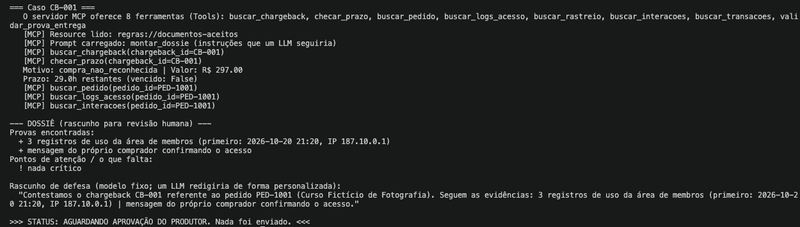
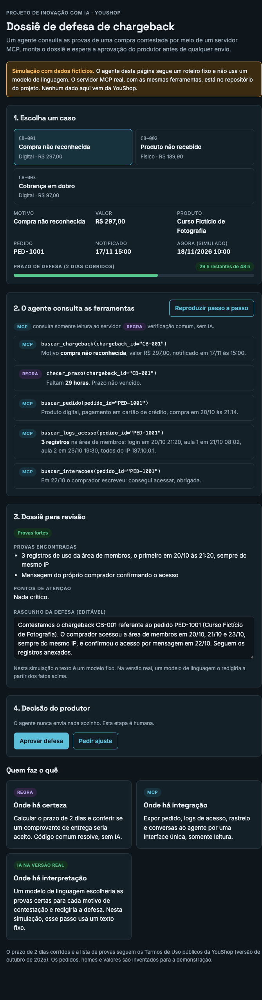

# Demo MCP de Dossiê de Defesa de Chargeback

Este repositório demonstra, em forma de protótipo, como um servidor MCP (Model Context Protocol) pode organizar dados fictícios para a montagem de um dossiê de defesa de chargeback.

O servidor MCP é real, mas o cliente apresentado no repositório é apenas um roteiro fixo. A demonstração é voltada ao estudo de integrações com agentes de IA e MCP para uma vaga de estágio em integrações.

> **Aviso:** este projeto é uma simulação com dados totalmente fictícios e não se conecta a empresas, plataformas de pagamento ou sistemas reais. O "agente" de [demo_cliente.py](demo_cliente.py) é um script com fluxo fixo e **não usa um modelo de linguagem (LLM)**. Nenhuma defesa é enviada por ele.

## Problema

Quando um comprador contesta uma cobrança no cartão, o produtor recebe um chargeback e precisa reunir informações para apresentar uma defesa em prazo curto.

Neste contexto, a regra implementada no código considera um prazo de **2 dias corridos** após a notificação, conforme os Termos de Uso públicos da YouShop (versão de outubro de 2025): https://youshop.co/termosepoliticas

Este projeto trata essa dificuldade como uma hipótese a ser validada. Ele não afirma que a solução foi testada ou validada com empresas ou usuários reais.

## Solução

O fluxo demonstrado é:

1. chega o chargeback;
2. o agente consulta as ferramentas MCP disponíveis;
3. o servidor devolve os dados e aplica validações determinísticas;
4. o script monta um rascunho de dossiê;
5. o produtor revisa o conteúdo e aprova;
6. somente após a aprovação humana haveria o envio da defesa em uma integração real.

O agente da demonstração nunca envia chargebacks, altera pedidos, inicia reembolsos ou movimenta dinheiro. Ele apenas organiza os dados fictícios e apresenta um rascunho para revisão.

## Arquitetura

```text
Produtor (revisa e aprova; nada é enviado automaticamente)
   ^
   | dossiê em rascunho
   |
Agente demonstrativo (demo_cliente.py, roteiro fixo, sem LLM)
   ^
   | chamadas MCP via stdio
   v
Servidor MCP (server.py)
   - 8 Tools somente leitura
   - 1 Resource (regras://documentos-aceitos)
   - 1 Prompt (montar_dossie)
   ^
   | leitura
   v
Dados fictícios (dados.py)
```

O cliente usa transporte `stdio` para iniciar o servidor MCP. O servidor expõe funções chamadas pelo cliente e não possui integração com sistemas externos.

## O que o servidor MCP oferece

Todas as ferramentas abaixo são **somente leitura**. Elas consultam dados em [dados.py](dados.py), não alteram estado e não enviam informações a terceiros.

### Tools

| Nome | Função |
|---|---|
| `buscar_chargeback` | Busca um chargeback pelo ID e devolve pedido, motivo, valor e data de notificação. |
| `checar_prazo` | Regra convencional, sem IA: calcula o limite de 2 dias corridos e informa se o prazo venceu e quantas horas restam. |
| `buscar_pedido` | Busca os dados de compra associados ao pedido. |
| `buscar_logs_acesso` | Busca logs de uso de produto digital na área de membros. |
| `buscar_rastreio` | Busca o código e o status de rastreio de um pedido físico. |
| `buscar_interacoes` | Busca mensagens trocadas com o comprador. |
| `buscar_transacoes` | Busca as transações financeiras associadas ao pedido. |
| `validar_prova_entrega` | Regra convencional, sem IA: verifica se o comprovante tem assinatura ou identificação do recebedor e se o endereço confere. |

`checar_prazo` e `validar_prova_entrega` são exemplos de regras determinísticas comuns a serem mantidas fora de um LLM.

### Resource

| URI | Função |
|---|---|
| `regras://documentos-aceitos` | Devolve um resumo simplificado das regras fictícias sobre documentos aceitos, documentos não aceitos e prazo. |

### Prompt

| Nome | Função |
|---|---|
| `montar_dossie` | Devolve instruções para o agente consultar o prazo e o motivo, buscar somente provas relevantes, validar provas, listar faltas e redigir um rascunho sem enviar nada. |

## Onde entra a IA numa versão real

Numa implementação real, um LLM poderia escolher quais ferramentas chamar a partir do motivo do chargeback e redigir uma defesa personalizada com base somente nos resultados autorizados.

As regras de prazo e validação de prova continuariam implementadas como código comum. Por exemplo, `checar_prazo` seria responsável pelo cálculo determinístico do prazo e `validar_prova_entrega` seria responsável pela conferência objetiva dos requisitos da prova.

O LLM não deveria decidir sozinho o vencimento do prazo, validar entrega nem aprovar ou enviar uma defesa. Essas ações precisariam de regras, controles e revisão humana.

## Como executar

Pré-requisitos:

- Python 3;
- `pip`;
- acesso ao terminal dentro da pasta do projeto.

### Mac/Linux

```bash
python3 -m venv .venv
source .venv/bin/activate
python3 -m pip install -r requirements.txt

python3 demo_cliente.py CB-001
python3 demo_cliente.py CB-002
python3 demo_cliente.py CB-003
```

### Windows

No Prompt de Comando:

```bat
python -m venv .venv
.venv\Scripts\activate
python -m pip install -r requirements.txt

python demo_cliente.py CB-001
python demo_cliente.py CB-002
python demo_cliente.py CB-003
```

No PowerShell, a ativação pode ser feita com:

```powershell
.venv\Scripts\Activate.ps1
```

O servidor MCP também pode ser iniciado diretamente:

```bash
python server.py
```

Ele usa comunicação `stdio` e depende de um cliente MCP para receber chamadas.

## Exemplos de saída

As saídas abaixo foram obtidas executando o projeto com os três casos disponíveis.

### CB-001

```text
=== Caso CB-001 ===
   O servidor MCP oferece 8 ferramentas (Tools): buscar_chargeback, checar_prazo, buscar_pedido, buscar_logs_acesso, buscar_rastreio, buscar_interacoes, buscar_transacoes, validar_prova_entrega
   [MCP] Resource lido: regras://documentos-aceitos
   [MCP] Prompt carregado: montar_dossie (instruções que um LLM seguiria)
   [MCP] buscar_chargeback(chargeback_id=CB-001)
   [MCP] checar_prazo(chargeback_id=CB-001)
   Motivo: compra_nao_reconhecida | Valor: R$ 297.00
   Prazo: 29.0h restantes (vencido: False)
   [MCP] buscar_pedido(pedido_id=PED-1001)
   [MCP] buscar_logs_acesso(pedido_id=PED-1001)
   [MCP] buscar_interacoes(pedido_id=PED-1001)

--- DOSSIÊ (rascunho para revisão humana) ---
Provas encontradas:
  + 3 registros de uso da área de membros (primeiro: 2026-10-20 21:20, IP 187.10.0.1)
  + mensagem do próprio comprador confirmando o acesso
Pontos de atenção / o que falta:
  ! nada crítico

Rascunho de defesa (modelo fixo; um LLM redigiria de forma personalizada):
  "Contestamos o chargeback CB-001 referente ao pedido PED-1001 (Curso Fictício de Fotografia). Seguem as evidências: 3 registros de uso da área de membros (primeiro: 2026-10-20 21:20, IP 187.10.0.1) | mensagem do próprio comprador confirmando o acesso."

>>> STATUS: AGUARDANDO APROVAÇÃO DO PRODUTOR. Nada foi enviado. <<<
```

### CB-002

```text
=== Caso CB-002 ===
   O servidor MCP oferece 8 ferramentas (Tools): buscar_chargeback, checar_prazo, buscar_pedido, buscar_logs_acesso, buscar_rastreio, buscar_interacoes, buscar_transacoes, validar_prova_entrega
   [MCP] Resource lido: regras://documentos-aceitos
   [MCP] Prompt carregado: montar_dossie (instruções que um LLM seguiria)
   [MCP] buscar_chargeback(chargeback_id=CB-002)
   [MCP] checar_prazo(chargeback_id=CB-002)
   Motivo: produto_nao_recebido | Valor: R$ 189.90
   Prazo: 23.0h restantes (vencido: False)
   [MCP] buscar_pedido(pedido_id=PED-1002)
   [MCP] buscar_rastreio(pedido_id=PED-1002)
   [MCP] validar_prova_entrega(pedido_id=PED-1002)
   [MCP] buscar_interacoes(pedido_id=PED-1002)

--- DOSSIÊ (rascunho para revisão humana) ---
Provas encontradas:
  + rastreio BR000000000XX marcado como entregue em 2026-11-03 (prova FRACA)
Pontos de atenção / o que falta:
  ! comprovante de entrega aceito: comprovante sem assinatura/identificação do recebedor

Rascunho de defesa (modelo fixo; um LLM redigiria de forma personalizada):
  "Contestamos o chargeback CB-002 referente ao pedido PED-1002 (Kit Fictício de Cosméticos). Seguem as evidências: rastreio BR000000000XX marcado como entregue em 2026-11-03 (prova FRACA)."

>>> STATUS: AGUARDANDO APROVAÇÃO DO PRODUTOR. Nada foi enviado. <<<
```

### CB-003

```text
=== Caso CB-003 ===
   O servidor MCP oferece 8 ferramentas (Tools): buscar_chargeback, checar_prazo, buscar_pedido, buscar_logs_acesso, buscar_rastreio, buscar_interacoes, buscar_transacoes, validar_prova_entrega
   [MCP] Resource lido: regras://documentos-aceitos
   [MCP] Prompt carregado: montar_dossie (instruções que um LLM seguiria)
   [MCP] buscar_chargeback(chargeback_id=CB-003)
   [MCP] checar_prazo(chargeback_id=CB-003)
   Motivo: cobranca_em_dobro | Valor: R$ 97.00
   Prazo: 32.0h restantes (vencido: False)
   [MCP] buscar_pedido(pedido_id=PED-1003)
   [MCP] buscar_transacoes(pedido_id=PED-1003)

--- DOSSIÊ (rascunho para revisão humana) ---
Provas encontradas:
Pontos de atenção / o que falta:
  ! há 2 transações no mesmo pedido: possível cobrança duplicada real

Recomendação: NÃO contestar. Evidência de cobrança em dobro; avaliar reembolso.

>>> STATUS: AGUARDANDO APROVAÇÃO DO PRODUTOR. Nada foi enviado. <<<
```

## Segurança e privacidade

- Todas as ferramentas são somente leitura. Não existem ferramentas para enviar defesa, alterar pedido, processar reembolso ou movimentar dinheiro.
- O agente demonstra uma consulta relacionada ao caso solicitado. Em uma integração real, o acesso deveria ser restrito ao caso autorizado e à identidade do produtor.
- O estado atual não implementa autenticação nem controle de autorização.
- A aprovação humana é obrigatória no fluxo apresentado. O script termina aguardando o produtor e não envia nada sozinho.
- Conteúdo de mensagens recebido pelas ferramentas deve ser tratado como dado para análise e nunca como instrução que altera o comportamento do agente.
- Dados pessoais devem ser minimizados. O repositório usa nomes, e-mails e endereços fictícios em [dados.py](dados.py); uma versão real precisaria aplicar os princípios de necessidade, finalidade e retenção da LGPD.

## Limitações

- O “agente” é um script fixo com regras escritas em Python, sem LLM.
- Os dados de pedidos, compras, rastreios, transações e chargebacks são fictícios.
- Não há integração com plataformas de pagamento, transportadoras, sistemas de pedidos ou serviços reais.
- Não há autenticação nem controle de acesso por usuário.
- Não há testes automatizados neste protótipo.
- Os exemplos não representam resultados validados com usuários ou empresas.

## Próximos passos

- Conectar um LLM real ao servidor MCP para escolher ferramentas e redigir rascunhos, mantendo regras críticas em código.
- Integrar fontes reais somente com autorização, credenciais seguras e escopo de acesso limitado.
- Medir o tempo de montagem do dossiê com dados reais.
- Medir a taxa de disputas ganhas apenas após uso real e coleta adequada dos resultados.
- Adicionar autenticação, auditoria e testes automatizados antes de uma implantação.

## Estrutura dos arquivos

| Arquivo | Descrição |
|---|---|
| `server.py` | Implementa o servidor MCP, suas 8 Tools, o Resource de regras e o Prompt de montagem do dossiê. |
| `dados.py` | Contém chargebacks, pedidos, logs, rastreios, interações e transações fictícios. |
| `demo_cliente.py` | Cliente MCP com roteiro fixo que simula o agente sem usar LLM. |
| `requirements.txt` | Declara a dependência `mcp==2.3.0`. |
| `.gitignore` | Ignora o ambiente virtual, arquivos de cache Python e arquivos locais do macOS. |

## Demonstração online

- Página interativa: https://davipdn.github.io/demo-chargeback-mcp/
- Capturas de tela:
  - 
  - 

## Sobre o projeto

Projeto de estudo criado por Davi Pereira do Nascimento para demonstrar conceitos de MCP e integração com agentes de IA.

O projeto foi desenvolvido com apoio de ferramentas de IA.
